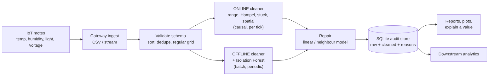

# AI Data Cleaning for IoT Sensor Streams

A layered, explainable system that finds and repairs faulty readings in multi-sensor IoT data (temperature, humidity, light, voltage). It never deletes raw data: every change is logged with its reason. A built-in simulator provides ground truth, so every claim is measured.

**Milestone map (M1-M5):** see [`docs/MILESTONES.md`](docs/MILESTONES.md).

## Quick start
```bash
pip install -r requirements.txt
python -m pytest -q tests                 # 9 tests, about 20 s
python demo.py                            # scored demo on a simulated network -> results/
python main.py simulate --out data/demo.csv
python main.py clean --input data/demo.csv --mode batch      # offline: all 5 layers
python main.py clean --input data/demo.csv --mode stream     # online: causal, no look-ahead
python main.py report                     # flag rate per channel
python main.py explain --mote 3 --channel humidity           # why were values changed?
python demo.py --stream                   # replay faults and repairs reading by reading
python demo.py --intel data.txt.gz        # REAL Intel Lab data (download first; unscored)
python experiments.py && python experiments_novel.py         # reproduce every number (about 5 min)
```
Run commands from the project folder (the one containing `demo.py`), otherwise `import src` fails.

## Architecture


```
CSV / stream -> validate (schema, sort, dedupe, regular 5-min grid)
  -> ONLINE cleaner  (src/stream.py):   range | Hampel | stuck | spatial        (past data only)
  -> OFFLINE cleaner (src/cleaning.py): the same + Isolation Forest             (can look ahead)
  -> repair (linear for short gaps, neighbour model for long gaps)
  -> SQLite audit store (src/store.py): raw + cleaned + flag + reason
  -> reports / explain / plots
```
Why layered: cheap rules are precise but narrow; the ML layer is broad but fuzzy. The spatial layer (compare a sensor with its neighbours) is the only one that sees slow bias and drift. All thresholds live in `src/config.py`.

## Results (simulated: 8 sensors x 7 days x 4 channels, about 10% faulty points; 5 seeds, mean)
| Configuration | Precision | Recall | F1 |
|---|---|---|---|
| Rules only (range + stuck) | 1.000 | 0.238 | 0.356 |
| Hampel only | 0.954 | 0.015 | 0.029 |
| Spatial only | 0.986 | 0.827 | 0.898 |
| Isolation Forest only | 0.887 | 0.254 | 0.394 |
| **Hybrid (all five)** | 0.950 | 0.936 | **0.942** |
| Hybrid minus spatial | 0.929 | 0.471 | 0.616 |
| Hybrid minus Isolation Forest | 0.980 | 0.936 | 0.957 |

Value error against the hidden true signal falls 96.5%. Other findings (full tables in `results/experiments.md`):
- A supervised Random Forest trained on labelled faults ties the unsupervised hybrid (both F1 0.942).
- The Isolation Forest slightly lowers F1 on known fault types, but raises recall on a novel fault from 0.61 to 0.71 (E7): it is insurance.
- The causal online cleaner scores F1 0.70-0.91 by channel against 0.91-0.95 offline.
- The spatial layer needs neighbours: F1 0.72 with 2 sensors, 0.96 with 8.

## Honest limitations
- Scores come from a **simulator** (smoother and more correlated than real sensors). The real Intel Lab data has no fault labels, was not downloadable in the build environment, and has **not been run through the pipeline**; the loader is tested only on the line format.
- Very short online runs (2 days) flag more than long ones because of detector warm-up (ERROR_LOG E-06).
- Thresholds were tuned on simulated data and need re-tuning on real data.
- The online cleaner has no machine-learning layer and is clearly less accurate than the offline one.

## Layout
`src/` simulator, cleaning pipeline, online cleaner, audit store, metrics, loader | `main.py` CLI | `demo.py`, `experiments*.py` | `tests/` | `docs/` (M1 proposal, literature, datasets, M2 design, milestone map, demo script) | `results/` | `ERROR_LOG.md` (7 entries: symptom, cause, fix, how to test)

## References
See `docs/LITERATURE_REVIEW.md`. Intel Lab dataset: https://db.csail.mit.edu/labdata/labdata.html
