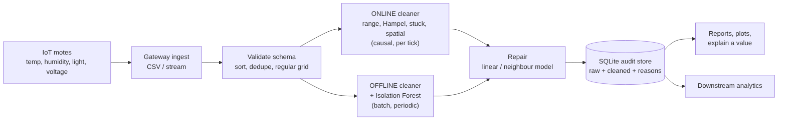

# M2 - System Design

## 1. System architecture

| Component | File | Responsibility |
|---|---|---|
| Ingest + validation | `main.py::ingest`, `src/cleaning.py::regularise` | Reject files with missing columns; sort; drop duplicate (time, mote); put every mote on a regular 5-minute grid so dropped packets become explicit missing values |
| Online cleaner | `src/stream.py` | Causal, one time-tick at a time, bounded memory; range, Hampel, stuck, spatial layers; emits cleaned value + reason |
| Offline cleaner | `src/cleaning.py` | Same layers with centred windows, plus Isolation Forest; run periodically over stored history |
| Repair | `impute()` / `StreamCleaner._repair` | Short gaps (<=3) linear; long gaps = neighbour median + the mote's learned offset |
| Audit store | `src/store.py` | SQLite table `readings(raw, cleaned, flagged, missing, reasons)`; raw is never overwritten |
| Reporting | `demo.py`, `main.py report/explain` | Plots, per-channel flag rates, "why was this value changed?" |
| Experiments | `experiments.py`, `experiments_novel.py` | All numbers in the report |

Design principle: **flag, explain, repair - never delete.** Every change is reversible and carries a reason.

## 2. Data pipeline design
1. **Schema:** `timestamp, mote_id, temperature, humidity, light, voltage` (same as the Intel Lab dataset, so real data drops in via `src/loader.py`).
2. **Regular grid:** Intel Lab reports every ~31 s with irregular gaps; the loader resamples to the median per 5 minutes (documented side-effect: this smooths very short spikes, so real-data flag rates are conservative).
3. **Masking before statistics:** impossible values (e.g. 122 C) are masked *before* any rolling statistic, otherwise one sentinel poisons its neighbours' features.
4. **Two speeds:** online path for latency (decisions with past data only, proven by `test_stream_cleaner_is_accurate_and_causal`); offline path for accuracy (can look ahead).
5. **Config in one file** (`src/config.py`) so every threshold is a visible, testable design choice.

## 3. Algorithm selection
| Need | Chosen | Why | Alternatives considered |
|---|---|---|---|
| Impossible values | Physical range rules | Zero false positives, free, explainable | none needed |
| Isolated spikes | Hampel (median + MAD) | Robust: spikes do not distort their own detector, unlike mean/std z-score | z-score (fails: outlier inflates std) |
| Frozen sensor | Run-length rule (>=8 identical), ignoring legitimate zero light | Direct match to the fault; 0 FPs in tests | - |
| Slow bias / drift | Spatial consistency vs neighbours (smoothed, robust sigma) | Point-wise methods cannot see slow faults; spatial alone reaches F1 0.90 | Kalman/ARIMA residuals (not tested: would absorb a slow drift into the forecast) |
| Unknown fault types | Isolation Forest on 6 engineered features | Unsupervised: needs no labels; E7 shows +9 pts recall on a novel fault | LSTM autoencoder / DBSCAN (not tested: heavier / more tuning; no benefit evidence); supervised Random Forest (tested, see below) |
| Repair | Linear then neighbour model | Linear is accurate for short gaps; long gaps need outside information | Mean imputation (biased by the daily cycle) |

Evidence from experiments (`results/experiments.md`):
- **Ablation (E1):** dropping the spatial layer collapses F1 from 0.94 to 0.62 - the most important component. Dropping the stuck rule costs 0.05.
- **Supervised comparison (E5):** a Random Forest trained on 3 labelled seeds scores F1 0.942, identical to our unsupervised hybrid - but it needs labelled faults that real deployments rarely have.
- **Honest finding (E1/E7):** on *known* fault types the ML layer slightly lowers F1 (0.958 -> 0.943); it earns its place on *novel* faults (0.872 -> 0.899). We keep it, with a low contamination setting, as insurance.
- **Online vs offline (E6):** the causal version scores lower (F1 0.70-0.91 vs 0.91-0.95) because it cannot look ahead; that is the price of live operation.

## 4. Ethical analysis
| Issue | Risk | Mitigation in this design |
|---|---|---|
| **Erasing real events** | A fire or door opening looks like a spike; "cleaning" could hide a genuine alarm | Never delete; keep raw + reason; flag rate reports; safety-critical deployments should alert on `flagged` clusters instead of silently repairing |
| **Privacy** | Light/temperature patterns reveal occupancy and routines in homes/offices | Data minimisation (only 4 channels, no identity); store locally in SQLite; document consent/retention when deploying; comply with the data-protection law of the deployment country (e.g. POPIA, GDPR) |
| **Bias / unequal quality** | Sensors in poorer/older buildings fail more; per-mote flag rates may differ; the spatial layer fails for isolated motes (E4: F1 0.72 with 2 motes) | Report per-mote flag rates; require minimum neighbours; fall back to non-spatial layers and say so |
| **Over-trust / automation bias** | Users believe cleaned data is "true" | `cleaned` is an estimate; keep `explain` command; report RMSE only where ground truth exists |
| **Evaluation honesty** | Synthetic data flatters the method | State plainly: scores are from a simulator; real Intel Lab data unscored (no labels) |
| **Reproducibility** | Unverifiable claims | Fixed seeds, one-command experiments, tests in CI-ready form |
| **Energy** | Heavy models on battery devices | Online path is median/MAD arithmetic only; ML runs offline on the server |
