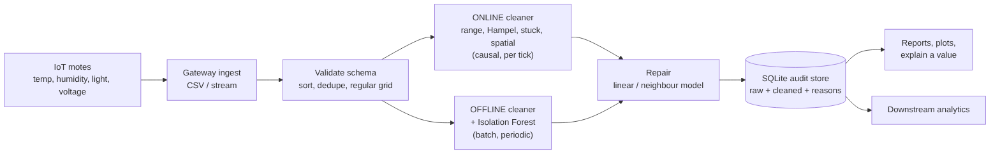
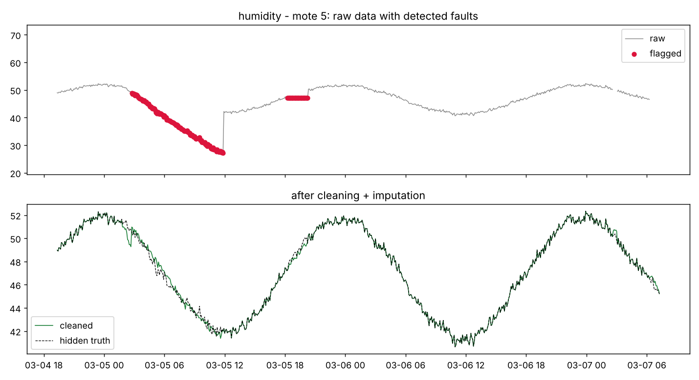

# AI Data Cleaning for IoT Sensor Streams - Technical Report

Nov 16, 2026 · Joshua (Lt) and group. This is a text copy of the online report; the online document is the master (see `M5_DELIVERABLES.md`). Figures are `img/architecture.png` and `../results/before_after_humidity.png`.

## Abstract

A layered cleaning pipeline detects 94% of injected sensor faults with 95% precision (F1 0.942 ± 0.010 over five simulated networks) and cuts value error against the hidden true signal by 96.5%. IoT sensors report spikes, frozen values, bias, drift, impossible readings and missing data. We combine physical range rules, a Hampel filter, a stuck-sensor rule, a spatial-consistency test against neighbouring sensors, and an unsupervised Isolation Forest, followed by neighbour-based repair. Every change is logged with its reason in an audit database and raw data is never deleted.

Three findings matter most. First, the spatial test is the most valuable layer: removing it drops F1 from 0.94 to 0.62. Second, the unsupervised hybrid matches a supervised Random Forest trained on labelled faults (both F1 0.942) without needing labels. Third, the Isolation Forest slightly lowers F1 on fault types we wrote rules for (0.958 to 0.943) but raises recall on a novel fault type from 0.61 to 0.71, so it works as insurance against unknown faults.

Limits: all scores come from a simulator, because the real Intel Lab dataset has no fault labels and could not be downloaded in our build environment. A causal online version, required for live use, scores lower (F1 0.70 to 0.91 by channel) because it cannot look ahead.

## 1. Introduction and problem statement

Bad sensor data leads to bad decisions, and at IoT scale nobody can clean it by hand. Sensor networks produce streams with missing values, impossible readings, isolated spikes, frozen sensors, bias and slow drift, caused by hardware wear, flat batteries and lost packets. Analytics, dashboards and control systems built on this data inherit its errors.

Single-technique cleaners miss whole fault classes: a point-wise outlier filter cannot see a sensor that has drifted by three degrees over a day, and a range rule cannot see a frozen value that is still plausible. Published methods are also hard to compare because they are tested on private datasets with differing protocols (Teh et al., 2020). We therefore ask: **can a layered, explainable pipeline combining rules, robust statistics, spatial redundancy and an unsupervised model detect and repair the main IoT sensor faults, and can we measure that honestly?**

## 2. Objectives and outcome

| # | Objective | Target | Result | Met? |
| --- | --- | --- | --- | --- |
| 1 | End-to-end pipeline: ingest, validate, detect, repair, report | working CLI and tests | `main.py`, 9 passing tests | Yes |
| 2 | Detect six fault types (spike, stuck, bias, drift, out-of-range, missing) | F1 ≥ 0.90 | F1 0.942 ± 0.010 (5 seeds) | Yes |
| 3 | Reduce value error against the true signal | RMSE ≥ 90% lower | 96.5% lower | Yes |
| 4 | Demonstrate on real data and measure on labelled data | Intel Lab run + scored benchmark | scored on simulator only; real-data run not yet done | Partly |

## 3. Literature review

**Sensor data quality.** A systematic review of 57 papers (screened from 6,970 records) found missing data and faults such as outliers, bias and drift to be the most common errors, with PCA and neural networks behind about 40% of detection methods and Bayesian networks and association-rule mining common for correction (Teh et al., 2020). Its main criticism is that methods cannot be compared, because evaluation protocols differ and datasets are often private. We address that with an open simulator that supplies ground truth, plus fixed seeds.

**Benchmarks.** de Bruijn et al. (2016) argue that a fault benchmark needs real raw data, labelled faults per point, and a fault taxonomy; they release Intel Lab, SensorScope and Smart Santander subsets with injected random, malfunction, bias, drift and polynomial-drift faults. Our simulator follows this taxonomy. The Numenta Anomaly Benchmark (Lavin and Ahmad, 2015) provides 58 labelled streams and a scoring scheme that rewards early detection, which is relevant to our online variant. The Intel Berkeley Research Lab dataset (Bodik et al., 2004) has 54 motes and about 2.3 million readings and contains real faults such as a 122 °C temperature, but no labels.

**Techniques.** Range rules need no learning. The Hampel filter flags points far from the window median in robust units (median absolute deviation), so outliers do not distort their own detector (Hampel, 1974). Isolation Forest isolates anomalies with random splits and needs no labels (Liu, Ting and Zhou, 2008). Declarative pipelines of smoothing and arbitration stages are an established pattern for sensor cleaning (Jeffery et al., 2006). Spatial redundancy between neighbouring sensors is used across the surveyed literature to expose faults a single series cannot show.

**Gap.** Existing work usually applies one technique to one private dataset. We (i) layer cheap explainable detectors with an unsupervised model, (ii) score every layer alone and in combination against ground truth, per fault type, and (iii) compare with a supervised baseline and an online variant.

## 4. System design

**Architecture.** Readings flow from the motes through ingest and validation into two cleaners that share the same detection layers: an online cleaner that sees only past data and runs per time tick, and an offline cleaner that can look ahead and adds the Isolation Forest. Both feed a repair step and an audit store, from which reports and downstream analytics read. The design principle is flag, explain, repair, and never delete: raw values are kept beside cleaned values and the reason for every change.

**Data pipeline.** The schema is `timestamp, mote_id, temperature, humidity, light, voltage`, identical to the Intel Lab dataset. Validation rejects files with missing columns, sorts, drops duplicate (time, mote) rows and places each mote on a regular five-minute grid so dropped packets become explicit missing values. Impossible values are masked before any rolling statistic is computed, otherwise one sentinel such as 122 °C poisons the features of its neighbours. All thresholds live in one configuration file so each is a visible, testable design choice.

**Algorithm selection.**

| Need | Chosen | Why | Alternatives considered |
| --- | --- | --- | --- |
| Impossible values | Physical range rules | No false positives, free, explainable | none needed |
| Isolated spikes | Hampel filter (median and MAD) | Robust: spikes do not inflate their own detector | z-score (outlier inflates the standard deviation) |
| Frozen sensor | Run of 8 or more identical readings; zero light ignored | Direct match to the fault | none |
| Slow bias and drift | Spatial consistency against neighbouring motes | Point-wise methods cannot see slow faults; alone it reaches F1 0.90 | Kalman or ARIMA residuals (not tested; would absorb a slow drift into the forecast) |
| Unknown fault types | Isolation Forest on six engineered features | Unsupervised; adds recall on a novel fault (section 6, E7) | LSTM autoencoder, DBSCAN (not tested); supervised Random Forest (tested, E5) |
| Repair | Linear for gaps up to 3 samples, else neighbour median plus the mote's learned offset | Long gaps need outside information | mean imputation (ignores the daily cycle) |

**The spatial test.** For each mote the pipeline computes its difference from the median of all motes at the same time, removes the mote's own typical offset, smooths over 15 samples and flags sustained disagreement larger than 5 robust standard deviations. For light, each mote has its own gain, estimated from daytime only, so the residual is relative rather than additive.

## 5. Implementation and integration testing

The system is about 730 lines of Python (about 1,070 with the demo, experiments and tests) (pandas, NumPy, scikit-learn, matplotlib, SQLite) in `src/` plus a command-line entry point. `python main.py simulate` creates a labelled network, `clean --mode batch|stream` runs either cleaner and writes the audit database, `report` prints flag rates per channel and `explain` lists why a given mote's values were changed.

**Tests.** Nine automated tests pass. Unit tests check that Hampel flags a spike but not clean noise, that stuck-sensor detection ignores legitimate night-time zero light, and that the range rule catches 122.153 °C. Integration tests run the whole command-line flow in both modes and check that the audit database is populated, that malformed input is rejected with a clear message, and that the loader accepts the real Intel Lab line format. A causality test proves the online cleaner never uses the future: altering all data after a cut-off time leaves every earlier output unchanged.

**Bugs found and what they taught.** Each is logged with symptom, cause, fix and test in `ERROR_LOG.md`.

| # | Symptom | Root cause | Lesson |
| --- | --- | --- | --- |
| E-01 | Simulator corrupted 25 to 30% of points | Fault rate counted events, but drift events last hundreds of samples | Check your test data before trusting your scores |
| E-02 | Hampel flagged about 10% of clean data | Noise scale taken as a median of residuals against each point's own median, which is nearly zero in smooth data; correct form is the MAD of the window values | Re-derive textbook formulas; do not approximate them |
| E-03, E-04 | Thousands of false alarms on light at night | Half the residuals were exactly zero, collapsing any median-based noise estimate; per-mote gain was estimated across day and night | Robust statistics fail when more than half the values are identical |
| E-05 | Online Hampel flagged 60% of readings | Flagged values never entered its memory, so after a long fault its window was stale and every later reading looked wrong | A detector must see the same data the world produces, not only what it accepted |
| E-06 | Online light flags wrong on day 1 | Cold start: noise scale estimated from almost no daytime data | Require enough evidence before a detector may flag |

## 6. Experiments and results

**Setup.** A simulator generates 8 motes × 7 days × 4 channels at 5-minute sampling (about 64,000 readings) with a daily cycle, shared building-level signal and per-mote noise. It injects six fault types, with about 10% of points faulty, and records the true clean value and fault label of every point. Detection is scored as precision, recall and F1 on non-missing faults (missing values are trivially known); repair is scored as RMSE against the hidden truth. The unsupervised models see no labels. All tables below are reproduced by `python experiments.py` with fixed seeds and appear in `results/experiments.md`.

**E1. Which layers matter (5 seeds, mean ± std).** Spatial consistency is the strongest single layer and the most damaging to remove. The Hampel filter alone has very low recall (0.015) because most injected faults are long-lived and a short window absorbs them; it earns its place on isolated spikes and sentinel values, which dominate RMSE.

| Configuration | Precision | Recall | F1 | RMSE reduction (%) |
| --- | --- | --- | --- | --- |
| Rules (range + stuck) | 1.000 ± 0.000 | 0.238 ± 0.013 | 0.356 ± 0.016 | 47.8 ± 4.1 |
| Hampel | 0.954 ± 0.014 | 0.015 ± 0.002 | 0.029 ± 0.004 | 50.1 ± 3.9 |
| Spatial | 0.986 ± 0.011 | 0.827 ± 0.013 | 0.898 ± 0.011 | 19.0 ± 7.1 |
| Isolation Forest | 0.887 ± 0.009 | 0.254 ± 0.003 | 0.394 ± 0.005 | 10.4 ± 1.7 |
| **Hybrid (all five)** | 0.950 ± 0.015 | 0.936 ± 0.009 | **0.942 ± 0.010** | 96.5 ± 0.3 |
| Hybrid minus range | 0.955 ± 0.010 | 0.935 ± 0.009 | 0.945 ± 0.008 | 96.4 ± 0.4 |
| Hybrid minus Hampel | 0.950 ± 0.015 | 0.936 ± 0.009 | 0.943 ± 0.010 | 96.5 ± 0.3 |
| Hybrid minus stuck | 0.945 ± 0.015 | 0.842 ± 0.013 | 0.889 ± 0.012 | 96.2 ± 0.4 |
| Hybrid minus spatial | 0.929 ± 0.006 | 0.471 ± 0.007 | 0.616 ± 0.008 | 63.0 ± 3.8 |
| Hybrid minus Isolation Forest | 0.980 ± 0.016 | 0.936 ± 0.009 | 0.957 ± 0.011 | 96.3 ± 0.6 |

Removing the range rule or the Hampel filter changes F1 by 0.003 or less because the spatial and Isolation Forest layers also catch the large spikes they target; they remain useful as cheap, explainable first lines of defence.

**E2. Isolation Forest contamination (seed 11).** The contamination parameter is the fraction of points the model may flag. Raising it trades precision for recall; for the hybrid, F1 falls from 0.941 at 0.01 to 0.762 at 0.12, so we use 0.03 as a compromise: lower values give the model too little recall on novel faults (E7).

| Contamination | IF precision | IF recall | IF F1 | Hybrid precision | Hybrid recall | Hybrid F1 |
| --- | --- | --- | --- | --- | --- | --- |
| 0.01 | 0.907 | 0.084 | 0.153 | 0.962 | 0.920 | 0.941 |
| 0.02 | 0.903 | 0.170 | 0.287 | 0.953 | 0.920 | 0.936 |
| 0.03 | 0.890 | 0.252 | 0.393 | 0.941 | 0.920 | 0.930 |
| 0.05 | 0.804 | 0.381 | 0.517 | 0.889 | 0.921 | 0.904 |
| 0.08 | 0.713 | 0.542 | 0.615 | 0.799 | 0.922 | 0.854 |
| 0.12 | 0.567 | 0.647 | 0.604 | 0.650 | 0.924 | 0.762 |

**E3. Fault rate (hybrid, seed 21).** F1 stays between 0.89 and 0.94 from 2% to 15% faulty points and falls to 0.91 at 25%, where recall drops to 0.88. At very low fault rates precision falls because each false alarm weighs more against few true faults.

| Fault rate | Precision | Recall | F1 | RMSE reduction (%) |
| --- | --- | --- | --- | --- |
| 0.02 | 0.856 | 0.964 | 0.904 | 96.0 |
| 0.05 | 0.862 | 0.933 | 0.890 | 95.3 |
| 0.08 | 0.960 | 0.926 | 0.942 | 96.0 |
| 0.15 | 0.960 | 0.928 | 0.943 | 95.0 |
| 0.25 | 0.945 | 0.880 | 0.911 | 90.3 |

**E4. Number of sensors (seed 31).** The spatial layer needs neighbours: with two motes F1 is 0.72, rising to 0.96 at eight and flattening beyond.

| Motes | Spatial-only F1 | Hybrid F1 |
| --- | --- | --- |
| 2 | 0.687 | 0.722 |
| 3 | 0.728 | 0.793 |
| 4 | 0.864 | 0.892 |
| 8 | 0.917 | 0.955 |
| 16 | 0.917 | 0.946 |

**E5. Unsupervised versus supervised (test seeds 14 and 15).** A Random Forest trained on labelled faults from three other seeds reaches the same F1 as our unsupervised hybrid, but real deployments rarely have thousands of labelled faults.

| Model | Precision | Recall | F1 |
| --- | --- | --- | --- |
| Supervised Random Forest (3 labelled seeds) | 0.932 | 0.953 | 0.942 |
| Unsupervised hybrid (no labels) | 0.942 | 0.943 | 0.942 |

**E6. Online versus offline (seed 11).** The causal online cleaner, which omits the Isolation Forest and cannot look ahead, scores lower than the offline one: slow faults are confirmed only after the smoothing window fills. Humidity suffers most (F1 0.70 against 0.91).

| Channel | Online F1 | Offline F1 | Online precision / recall | Offline precision / recall |
| --- | --- | --- | --- | --- |
| Temperature | 0.849 | 0.948 | 0.856 / 0.842 | 0.957 / 0.938 |
| Humidity | 0.698 | 0.913 | 0.760 / 0.646 | 0.943 / 0.885 |
| Light | 0.868 | 0.908 | 0.858 / 0.878 | 0.897 / 0.920 |
| Voltage | 0.911 | 0.952 | 0.927 / 0.895 | 0.967 / 0.938 |

**E7. What is the ML layer for? (3 seeds).** We added a novel fault, a sudden eight-fold rise in noise, that no rule targets. With known faults only, the Isolation Forest lowers precision and F1 (0.958 to 0.943). When the novel fault appears, it lifts overall F1 from 0.872 to 0.899 and recall on the novel fault from 0.614 to 0.709.

| Scenario | Method | F1 | Precision | Recall | Novel-fault recall |
| --- | --- | --- | --- | --- | --- |
| Known faults only | Rules + Hampel + spatial | 0.958 | 0.986 | 0.932 | n/a |
| Known faults only | Full hybrid | 0.943 | 0.955 | 0.932 | n/a |
| Known + novel fault | Rules + Hampel + spatial | 0.872 | 0.993 | 0.783 | 0.614 |
| Known + novel fault | Full hybrid | 0.899 | 0.992 | 0.825 | 0.709 |

## 7. Discussion and limitations

The central result is that sensors vouch for each other. A sensor that drifts by three degrees looks normal to its own history but not to its neighbours, which is why one layer that costs a median and a subtraction beats the machine-learning model alone by a wide margin (F1 0.90 against 0.39). The ablation also shows that more layers are not automatically better: on known faults, the Isolation Forest lowers F1, and it justifies itself only as protection against fault types nobody anticipated.

Limitations we want the reader to weigh:

- **Synthetic evaluation.** Simulated motes are smoother and more strongly correlated than real ones, so real scores will be lower. The simulator was written by the same team that wrote the detectors, which can bias results.
- **Real data not yet scored.** The Intel Lab dataset has no fault labels, and the build environment could not download it. The loader is tested only on the file format.
- **Spatial dependence.** With two or three sensors, or a lone sensor in a distant room, the spatial layer weakens (E4).
- **Online gap.** The live-capable cleaner is clearly less accurate than the offline one (E6) and does not include the machine-learning layer.
- **Real events.** A genuine fire or door opening can resemble a spike or a bias. Flagging rather than deleting mitigates this but does not remove it.
- **Thresholds.** Values such as the 5-sigma spatial limit were tuned on simulated data and need re-tuning on real data.

## 8. Ethical analysis

| Issue | Risk | Mitigation in this design |
| --- | --- | --- |
| Erasing real events | A fire or an open door looks like a spike, so cleaning could hide a genuine alarm | Raw data and reasons are kept; safety-critical deployments should alert on clusters of flags instead of silently repairing |
| Privacy | Light and temperature patterns reveal occupancy and daily routines | Data minimisation (four channels, no identities), local storage, documented consent and retention, compliance with local data-protection law (for example POPIA or GDPR) |
| Unequal data quality | Sensors in older or poorer buildings may fail more, and isolated motes get weaker spatial checks (E4) | Report flag rates per mote; require a minimum number of neighbours; say so when falling back to non-spatial layers |
| Over-trust | Users may treat cleaned values as true measurements | Cleaned values are estimates; the `explain` command shows every change; RMSE is reported only where ground truth exists |
| Evaluation honesty | Synthetic data flatters the method | Scores are labelled as simulator results; real-data results will be reported separately |
| Reproducibility | Unverifiable claims | Fixed seeds, one-command experiments, automated tests |
| Energy | Heavy models drain battery devices | The online path is median arithmetic; machine learning runs on the server |

## 9. Team and process

The project followed five milestones: proposal, design, prototype, integration and final delivery. Roles below are proposed and need confirming by the group before submission.

| Member | Role |
| --- | --- |
| Lt (Joshua) | Dataset and literature search; pipeline, cleaning model, simulator, online cleaner, experiments |
| Member 2 (to confirm) | Literature review write-up, ethics section, report editing |
| Member 3 (to confirm) | Integration of labelled benchmark data, evaluation review, slides |

Process: all thresholds sit in one configuration file; every bug is written up in `ERROR_LOG.md`; every number in this report is regenerated by a script with fixed seeds.

## 10. Conclusion and future work

A layered pipeline that combines cheap explainable detectors, spatial agreement between sensors and an unsupervised model detects 94% of simulated sensor faults with 95% precision and removes 96.5% of the value error, matching a supervised model that needs labels. The most useful idea was the simplest: neighbouring sensors can check each other.

Next steps, in priority order:

1. Run the pipeline on the real Intel Lab data and review flagged points by eye, since no labels exist.
2. Add the labelled de Bruijn benchmark subsets for scoring on real signals with injected faults.
3. Close the online-offline gap, for example with a short look-ahead delay of a few samples.
4. Re-tune thresholds per deployment and add per-mote flag-rate monitoring.
5. Test a Kalman-filter and an autoencoder baseline, which this report names but does not evaluate.

## References

Checked means the source page or paper abstract was opened while writing. Others are cited from memory and should be verified before submission.

- Bodik, P., Hong, W., Guestrin, C., Madden, S., Paskin, M., Thibaux, R. (2004). Intel Berkeley Research Lab dataset. https://db.csail.mit.edu/labdata/labdata.html (checked)
- de Bruijn, B., Nguyen, T. A., Bucur, D., Tei, K. (2016). Benchmark datasets for fault detection and classification in sensor data. SENSORNETS, SciTePress, pp. 185-195. https://scitepress.org/Documents/2016/56379/ (checked)
- Lavin, A., Ahmad, S. (2015). Evaluating real-time anomaly detection algorithms: the Numenta Anomaly Benchmark. IEEE ICMLA. https://github.com/numenta/NAB (checked)
- Teh, H. Y., Kempa-Liehr, A. W., Wang, K. I.-K. (2020). Sensor data quality: a systematic review. Journal of Big Data 7, 11. https://doi.org/10.1186/s40537-020-0285-1 (abstract checked; confirm author list)
- Hampel, F. R. (1974). The influence curve and its role in robust estimation. Journal of the American Statistical Association 69(346), 383-393. (verify)
- Liu, F. T., Ting, K. M., Zhou, Z.-H. (2008). Isolation forest. IEEE International Conference on Data Mining, pp. 413-422. (verify)
- Jeffery, S. R., Alonso, G., Franklin, M. J., Hong, W., Widom, J. (2006). Declarative support for sensor data cleaning. Pervasive Computing, LNCS 3968, pp. 83-100. (verify)
